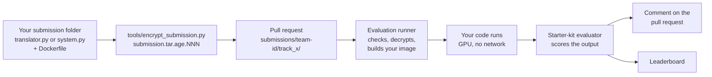
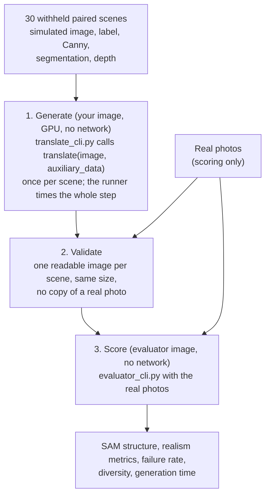
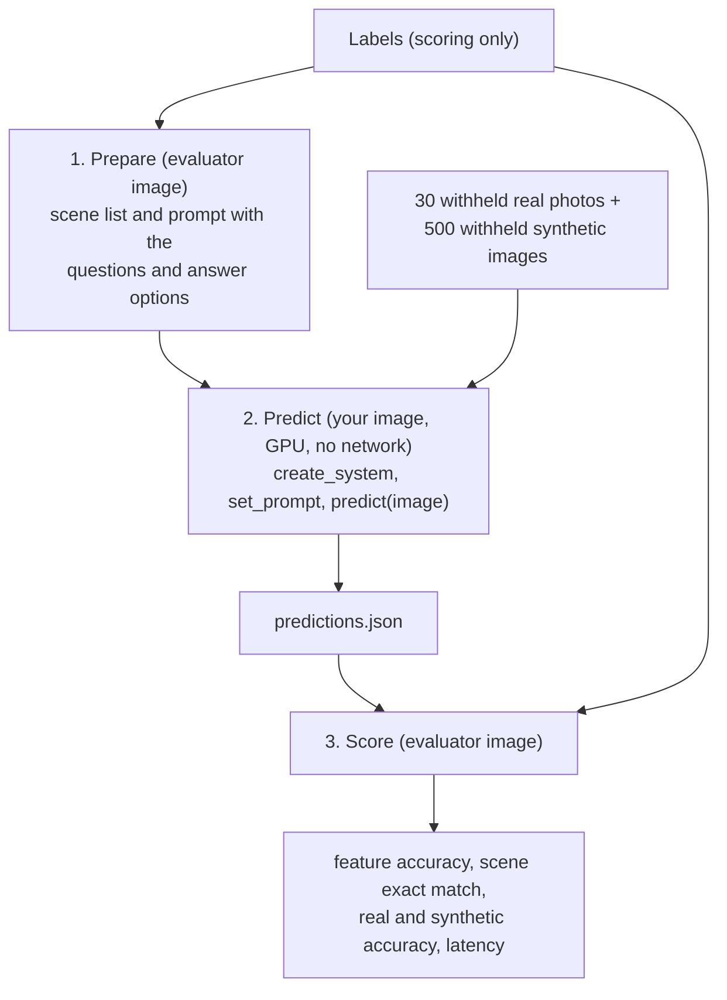

# ISU-Challenge Evaluation Guide

This guide describes how the official evaluation runs a submission, which data each step uses,
how every metric is computed, and how the leaderboard ranks teams. The track READMEs explain how
to build and test a submission: [Track A](track_a/README.md), [Track B](track_b/README.md).

## Contents

1. [Overview](#1-overview)
2. [Data](#2-data)
3. [Track A: test generation](#3-track-a-test-generation)
4. [Track B: in-car scene understanding](#4-track-b-in-car-scene-understanding)
5. [Submissions, limits, and runtime](#5-submissions-limits-and-runtime)
6. [Leaderboard and final evaluation](#6-leaderboard-and-final-evaluation)
7. [Reproducing the evaluation locally](#7-reproducing-the-evaluation-locally)
8. [Changes since the October 3 starter kit](#8-changes-since-the-october-3-starter-kit)

## 1. Overview

You submit code, not results. A pull request carries your encrypted submission folder; the
organizers' evaluation runner decrypts it, builds your Docker image, runs your code on the
withheld evaluation data without network access, scores the output with the starter-kit
evaluators, and posts the result on the pull request and on the
[leaderboard](https://isu-challenge.github.io).

The evaluator code is the starter kit at a fixed commit, which the pull-request comment reports as
`evaluator`. Your code never sees the data used only for scoring, and the scoring code never runs
inside your image.

## 2. Data

The organizers reconstructed 60 real in-car scenes in simulation. They are split in two halves:

| Paired scenes | Status | Use |
|---|---|---|
| `sample_00000` to `sample_00029` | published in the base dataset (simulated image, label, auxiliary channels, real photo) | development: the only real photos you may use |
| `sample_00030` to `sample_00059` | withheld | evaluation of both tracks |

Earlier versions of the base dataset contained the withheld half. Do not use those files in any
way (training, validation, tuning, lookup); this is checked in the manual review.

| | Your code receives | Used only for scoring | Scenes |
|---|---|---|---|
| Track A | simulated image, full label, Canny, instance segmentation, and depth of each scene | real photo of each scene | the 30 withheld paired scenes |
| Track B | RGB images, plus the questions and answer options (`set_prompt`) | labels | the 30 withheld real photos and 500 withheld synthetic scenes |

- The 500 withheld synthetic scenes were rendered for the evaluation with the same generator, scene,
  and feature configuration as the published synthetic scenes. They are named `eval_XXXXX` and are
  not part of any published dataset.
- File names follow the dataset: `images/<stem>_sim.png`, `labels/<stem>.json`,
  `real/<stem>_real.jpg`, `canny/<stem>_canny.png`, `instance_seg/<stem>_instance_seg.png`
  (colours in `instance_seg/instance_seg_class_map.json`), `depth/png/<stem>_depth.png`.

## 3. Track A: test generation

### 3.1 How a submission is evaluated

1. **Generate.** Your image runs [`track_a/translate_cli.py`](track_a/translate_cli.py) from the
   pinned starter kit: it calls `create_translator("cuda")` once and then
   `translate(image, auxiliary_data)` for every scene. `auxiliary_data` holds the scene `stem`, its
   full `label`, and its `canny`, `segmentation`, and `depth` images. The output is saved as
   `generated/<stem>.png`. If `translate` raises for any scene, the evaluation fails.
2. **Validate.** The submission is rejected when `generated/` does not hold exactly one readable
   image per scene with the size of its simulated image, or when a generated image reproduces a
   real photo (section 3.4).
3. **Score.** [`track_a/evaluator_cli.py`](track_a/evaluator_cli.py) computes the metrics below.

### 3.2 Metrics

The system under test (SUT) on the leaderboard is `Qwen/Qwen2.5-VL-3B-Instruct`; the final
evaluation adds an industrial system.

| Metric | Definition | Ranked |
|---|---|---|
| Scene failure rate | Share of the scenes in which at least one evaluated feature fails. | yes (higher is better) |
| Overall realism | Mean of the realism metrics, each min-max normalized across the ranked teams (section 3.3). | yes (higher is better) |
| Feature diversity | Mean pairwise Hamming distance between the evaluated label features of the failing scenes. | yes (higher is better) |
| Generation time | Wall-clock time of the generate step (container start, model loading, all scenes) divided by the number of scenes. | yes (lower is better) |
| Feature failure rate | Failing features divided by evaluated features over all scenes. | no, reported |
| Realism metrics | Generated images against the real photos: SSIM, PSNR, VGG perceptual distance, FID, KID, Inception Score, and the others of `REALISM_DIRECTIONS`. Simulated images against the real photos are reported for comparison. | through overall realism |
| SAM structure | Class-agnostic SAM segmentation of simulated and generated images, compared per scene (matched IoU, boundary F1). | no, reported |
| CLIP visual diversity | Mean pairwise cosine distance of CLIP ViT-B/32 embeddings of the failing generated images. | no, reported |

**Failure.** For each scene, the SUT answers the feature questions twice: for your generated image
and for the real photo of the same scene. A feature fails when the two answers differ; a scene
fails when any of its evaluated features fails. If a generated image is pixel-identical to the
real photo, the real-photo answers are reused. The evaluated features are the label features that
`public_features` in [`track_a/track_a_metrics.py`](track_a/track_a_metrics.py) keeps: occupancy,
seat belts, phone use, objects, suitcase, baby seat, and baby. Colours, emotions, genders,
environment, lighting, body size, and head angles are not evaluated. Features whose label is `null`
are skipped, except `baby`, which is always evaluated. The SUT may answer `UNKNOWN` for any feature.

### 3.3 Ranking

Each team's best submission is ranked against the best submissions of the other teams, as
`rank_contestants` in `track_a_metrics.py` does:

1. **Overall realism.** Every generated-versus-real realism metric (paired metrics averaged over the
   scenes, and the distribution metrics; standard deviations and image counts excluded) is min-max
   normalized across the ranked teams and reversed when lower is better; a metric with the same
   value for every team scores 0.5. A team's overall realism is the mean of its normalized metrics.
   It is therefore relative: it changes when other teams submit.
2. **Pareto fronts** over scene failure rate, overall realism, feature diversity, and generation
   time. A team dominates another when it is at least as good on every objective and better on one;
   front 1 holds the non-dominated teams. A team missing any of the four objectives is not ranked.
3. **Tie-break** within a front: failure rate, overall realism, and feature diversity are min-max
   normalized across the ranked teams and weighted 0.3, 0.4, and 0.3.

### 3.4 Rules checked during evaluation

- A generated image must be a translation of its own simulated scene and keep its size, framing,
  objects, and geometry (see the [Track A README](track_a/README.md#requirements)).
- Generated images that reproduce a real photo are rejected: every generated image is compared with
  every real photo (grayscale, 240x135, SSIM), and 0.75 or more rejects the submission. On the paired
  scenes, a simulated image reaches at most 0.39 against the real photos, while a copy reaches 1.00.
- Reproducing, retrieving, or blending in real photos in any other way, using the withheld scenes,
  and shipping precomputed outputs break the rules. All submissions are reviewed manually.

## 4. Track B: in-car scene understanding

### 4.1 How a submission is evaluated

1. **Prepare.** The scene list and the prompt are built from the labels with `build_vocabulary` and
   `build_prompt` ([`track_b/track_b_evaluator.py`](track_b/track_b_evaluator.py)). The prompt lists
   every scored feature with the answer options that occur in the evaluation labels.
2. **Predict.** Your image imports `system.py`, calls `create_system("cuda")` once,
   `set_prompt(prompt)` once if your system defines it, and `predict(image)` for every image (PIL,
   RGB). An exception counts as an empty answer for that image. Answers are kept when they are
   scalars (strings are cut to 256 characters, at most 200 keys).
3. **Score.** Answers are compared with the labels after `str(value).strip().upper()`.

### 4.2 Metrics

| Metric | Definition | Ranked |
|---|---|---|
| Feature accuracy | Correct features divided by evaluated features over all scenes. | yes |
| Accuracy real / synthetic | Feature accuracy on the real photos and on the synthetic scenes. | no, reported |
| Scene exact match | Share of scenes with every evaluated feature correct. | no, reported |
| Latency (leaderboard) | Wall-clock time of the predict step (container start, model loading, all images) divided by the number of images. | no, reported |
| Latency (per image) | Mean time around each `predict(image)` call, measured inside your process. | no, reported |

The scored features are `TRACK_B_FEATURES` in `track_b_evaluator.py` (see the
[feature schema](https://isu-challenge.github.io/feature-schema.html)); a feature whose label is
`null` (seat or object not present) is skipped, and a missing answer counts as wrong. Real photos
are scenes `<stem>`, synthetic images are scenes `<stem>_sim`.

### 4.3 Ranking

Teams are ordered by the feature accuracy of their best submission.

## 5. Submissions, limits, and runtime

How to prepare, test, encrypt, and open the pull request is described in
[Submitting via pull request](README.md#submitting-via-pull-request).

| Limit | Value |
|---|---|
| Evaluations | 3 per team and track within any 24 hours; every started evaluation counts |
| Submission size | 2,000 MB and 20,000 files before encryption |
| Docker build | `FROM isu-challenge-base` in the last stage, internet access, 30 minutes, image at most 40 GB |
| Runtime | NVIDIA GPU with at least 24 GB, 14 GB RAM, 4 CPU cores, no network, 2 hours for all scenes including model loading (Track B: 530 images) |
| File system | read-only except `/tmp` (4 GB); your folder is mounted read-only at `/submission`; unprivileged user |
| Pull request | changes only `submissions/<team_id>/track_a/` or `submissions/<team_id>/track_b/`, one track |

A pull request is rejected when its author is not a registered team member, when it changes other
files, when the submission is not encrypted with `tools/encrypt_submission.py`, or when the image
does not build. The comment states the reason; build and run logs stay with the organizers and are
shared on request.

## 6. Leaderboard and final evaluation

- Every scored evaluation is published with its team, commit, evaluator commit, and hardware. The
  leaderboard runs on an NVIDIA L4 GPU (24 GB). The pull-request comment lists the raw metrics; the
  Track A overall realism and ranking exist only on the leaderboard, where all teams are compared.
- The final evaluation re-runs the submissions on the same withheld data, with the industrial SUT
  in Track A, and measures time on a `g6e.2xlarge` instance (NVIDIA L40S). The organizers announce
  before the submission deadline which submission of a team enters the final evaluation.

## 7. Reproducing the evaluation locally

Track A: build your image, run `translate_cli.py` on the 30 paired scenes of the base dataset, and
score the result with `evaluator_cli.py --failure-model qwen`; the commands are under
[Test your submission locally](track_a/README.md#test-your-submission-locally).
`track_a_evaluator.ipynb` ranks every report in `track_a_evaluation_output/` with
`rank_contestants`, for example several versions of your generator. Generation time differs from
the official value, which the runner measures on its own hardware.

Track B: run `EvaluatorTrackB` in your image as shown under
[Test your submission locally](track_b/README.md#test-your-submission-locally), or
`evaluator_cli.py evaluate --data-dir ../data` without Docker. Locally you evaluate the published
scenes; the official run uses the withheld scenes.

## 8. Changes since the October 3 starter kit

- **Submissions are code.** Track A submits a `Translator` and Track B an `ISUSystem`, each with a
  `Dockerfile`, as an encrypted pull request. The organizers generate the Track A images and run the
  Track B systems; generation time is measured by the organizers.
- **Dev and test split.** Only the paired scenes `sample_00000` to `sample_00029` remain in the base
  dataset; `sample_00030` to `sample_00059` are withheld for the evaluation of both tracks.
- **Track A failure rate** is unchanged: answers for the generated image against answers for the real
  photo of the same scene. The per-feature failure rate is reported as well.
- **Track A ranking** follows the organizers' ranking: Pareto fronts over failure rate, overall
  realism (normalized across teams), feature diversity, and generation time, with the tie-break
  weights 0.3, 0.4, 0.3. It is now part of the starter kit (`rank_contestants`).
- **Real photos in Track B** are loaded from `real/<stem>_real.jpg`, the dataset's file name.
  Earlier versions of the loader looked for `real/<stem>.jpg` and silently evaluated synthetic
  images only.
- **Copy check:** generated images that reproduce a real photo are rejected (section 3.4).
- **Notebooks:** the Track A starter notebook translates the 30 paired scenes and downloads the
  auxiliary channels by default; the documented file names match the dataset.
